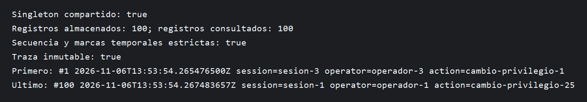

# Ejercicio 10 - Contenedor de estado global y auditoría de seguridad

`SecurityAuditLog.INSTANCE` es un Singleton `enum`, que bloquea la duplicación
por reflexión y serialización de enums. Cada evento es inmutable; los registros
se agregan bajo un mismo monitor y obtienen marca temporal estrictamente
creciente además de secuencia. La consulta entrega una copia no modificable.

## Compilar y ejecutar

Desde esta carpeta, en PowerShell:

```powershell
New-Item -ItemType Directory -Force out | Out-Null
javac -d out src\*.java
java -cp out Main
```

La carpeta `out` se puede quitar con `Remove-Item -Recurse -Force out`.

## Captura de salida


