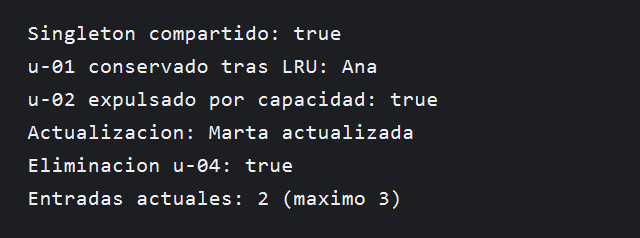

# Ejercicio 4 - Servicio de caché en memoria

Singleton con inicialización diferida y caché LRU limitada a 3 perfiles. La
implementación encapsula el mapa, valida claves, actualiza entradas existentes
y expulsa la menos recientemente usada cuando se supera la capacidad.

## Compilar y ejecutar

Desde esta carpeta, en PowerShell:

```powershell
New-Item -ItemType Directory -Force out | Out-Null
javac -d out src\*.java
java -cp out Main
```

La carpeta `out` contiene solo resultados de compilación locales y se puede
eliminar con `Remove-Item -Recurse -Force out`.

## Captura de salida


