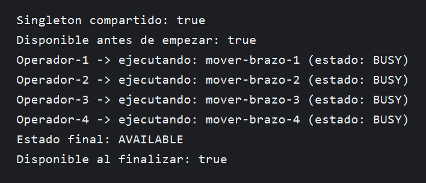

# Ejercicio 5 - Administrador de dispositivos de hardware únicos

El controlador usa un `enum` como Singleton resistente a duplicación y
serialización. Sus comandos son sincronizados, validan disponibilidad y
simulan el acceso exclusivo a un dispositivo robótico.

## Compilar y ejecutar

Desde esta carpeta, en PowerShell:

```powershell
New-Item -ItemType Directory -Force out | Out-Null
javac -d out src\*.java
java -cp out Main
```

La carpeta `out` se puede quitar con `Remove-Item -Recurse -Force out`.

## Captura de salida


