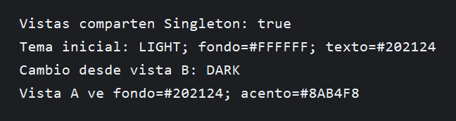

# Ejercicio 6 - Gestor de temas y apariencia visual

`ThemeManager` es un Singleton `enum` con acceso sincronizado al tema y a su
paleta. Las vistas consultan colores mediante métodos; la configuración no se
expone para modificación directa.

## Compilar y ejecutar

Desde esta carpeta, en PowerShell:

```powershell
New-Item -ItemType Directory -Force out | Out-Null
javac -d out src\*.java
java -cp out Main
```

La carpeta `out` se puede quitar con `Remove-Item -Recurse -Force out`.

## Captura de salida


