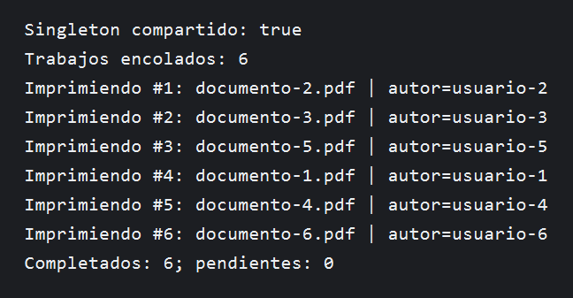

# Ejercicio 7 - Cola de impresión centralizada

La cola FIFO, sus metadatos y su secuencia de llegada pertenecen a un único
Singleton. La operación de agregar y la de procesar son sincronizadas; varios
productores concurrentes alimentan una sola cola.

## Compilar y ejecutar

Desde esta carpeta, en PowerShell:

```powershell
New-Item -ItemType Directory -Force out | Out-Null
javac -d out src\*.java
java -cp out Main
```

La carpeta `out` se puede quitar con `Remove-Item -Recurse -Force out`.

## Captura de salida


