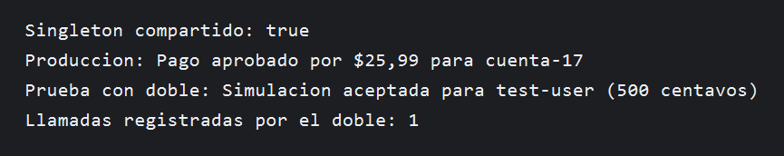

# Ejercicio 8 - Refactorización hacia inyección de dependencias

El consumidor `CheckoutService` depende de la interfaz `PaymentGateway` y
recibe su dependencia por constructor. El punto de composición elige la
instancia Singleton real; otra instancia falsa de prueba permite probar el
consumidor sin acoplarlo a pagos globales.

## Compilar y ejecutar

Desde esta carpeta, en PowerShell:

```powershell
New-Item -ItemType Directory -Force out | Out-Null
javac -d out src\*.java
java -cp out Main
```

La carpeta `out` se puede quitar con `Remove-Item -Recurse -Force out`.

## Captura de salida


