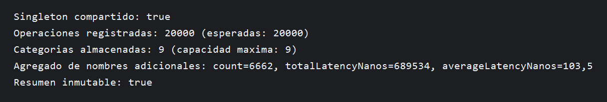

# Ejercicio 9 - Sistema de monitoreo de métricas de rendimiento

El colector Singleton agrega conteos y latencia sin un bloqueo global:
`ConcurrentHashMap` separa categorías y `LongAdder` agrega valores concurrentes.
La cardinalidad está limitada a 8 categorías con nombre más un agregado
reservado `_other_`, de modo que nombres adicionales no aumentan el uso de
memoria ni se pierden sus contadores.

## Compilar y ejecutar

Desde esta carpeta, en PowerShell:

```powershell
New-Item -ItemType Directory -Force out | Out-Null
javac -d out src\*.java
java -cp out Main
```

La carpeta `out` se puede quitar con `Remove-Item -Recurse -Force out`.

## Captura de salida


