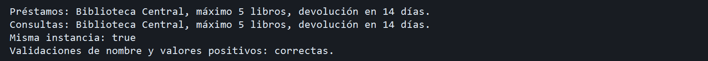

# Ejercicio 1 - Configuración general de una biblioteca

`LibraryConfiguration` es un Singleton con constructor privado. Préstamos y consultas leen el mismo objeto; las modificaciones se comparten y los setters rechazan nombres vacíos y números no positivos.



Desde esta carpeta, compilar y ejecutar con Java 8 o posterior:

```powershell
javac -d out src\Main.java
java -cp out Main
```
