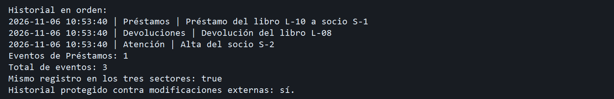

# Ejercicio 2 - Registro centralizado de actividades

Los sectores de préstamos, devoluciones y atención registran eventos fechados en una lista privada, compartida por Singleton. El historial y los filtros se devuelven como listas no modificables.



Desde esta carpeta:

```powershell
javac -d out src\Main.java
java -cp out Main
```
