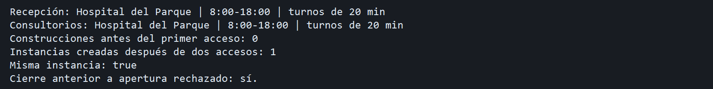

# Ejercicio 6 - Configuración general de un hospital

La configuración se construye de forma diferida, únicamente cuando se solicita por primera vez. Recepción y consultorios comparten horario, nombre y duración de turnos; se validan duración positiva y cierre posterior a apertura.



Desde esta carpeta:

```powershell
javac -d out src\Main.java
java -cp out Main
```
