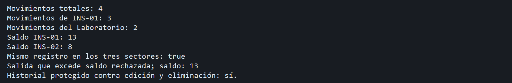

# Ejercicio 8 - Registro de movimientos de insumos

Depósito, consultorios y laboratorio agregan movimientos fechados a un registro Singleton. Cada insumo inicia con una entrada; las salidas requieren saldo suficiente. Las consultas permiten filtrar por insumo o sector y exponen historiales no modificables.



Desde esta carpeta:

```powershell
javac -d out src\Main.java
java -cp out Main
```
