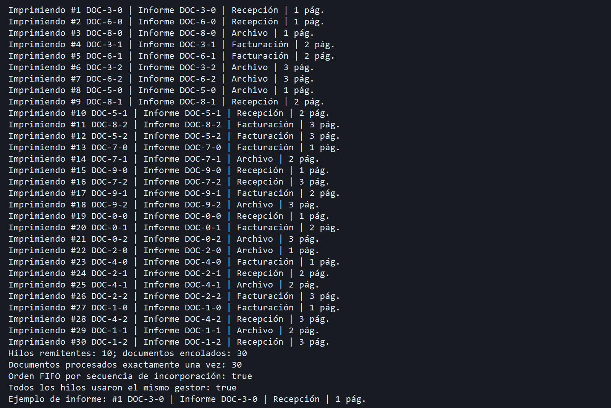

# Ejercicio 9 - Cola compartida de impresión

Diez hilos encolan treinta documentos únicos en un Singleton con operaciones sincronizadas. La cola conserva el orden de incorporación y el procesamiento simulado registra cada trabajo una sola vez, sin requerir una impresora física.



Desde esta carpeta:

```powershell
javac -d out src\Main.java
java -cp out Main
```
